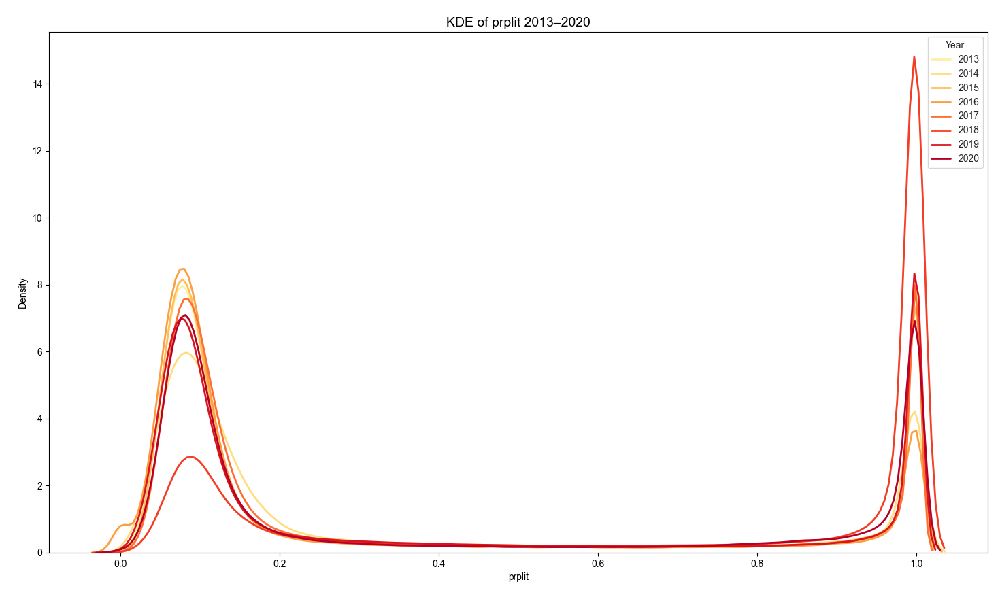

# Personal Projects — Cambria Jones

Data science and research projects in geospatial analysis, satellite data and global health.

## Projects

### [Power Reliability & Healthcare Access in Sub-Saharan Africa](subsaharan_africa/)
**Can satellite imagery tell us which health facilities are working without reliable electricity?**

A geospatial pipeline that pairs the locations of tens of thousands of public health facilities across Sub-Saharan Africa with nighttime satellite estimates of electricity access and reliability (HREA, 2013–2020).

- Mapped facility coverage with `geopandas` and `cartopy`, showing gaps across the Sahel, Namibia and Angola
- Built a GeoTIFF → CSV pipeline (affine transforms, nodata masking, 25% resampling) so continent-scale rasters can be analyzed on a laptop
- Used kernel density estimation to show that electricity reliability is **bimodal** (settlements are mostly dark or mostly lit) and shifted toward reliable power from 2013 to 2020
- Measured how much downsampling distorts the data, and included a statistically validated sample so the analysis runs straight after cloning

**Tools:** Python · rasterio · geopandas · cartopy · pandas · seaborn · matplotlib · AWS S3

[→ Full write-up and week-by-week breakdown](subsaharan_africa/README.md)
