# Ocean Sea Level and Atmospheric CO₂

**Is the rise in sea level proportional to the rise in atmospheric CO₂?**

This project compares 50+ years of global sea level measurements (EPA / CSIRO) with continuous atmospheric CO₂ readings from the Mauna Loa Observatory (Scripps). I fit polynomial models to each series, measured how fast each one changed across three decades using linear regression and LOWESS smoothing, and projected both to 2200 to test whether they grow in proportion.

The hypothesis was that the rise in CO₂ from fossil fuel use since the Industrial Revolution would be matched by a proportional rise in sea level.

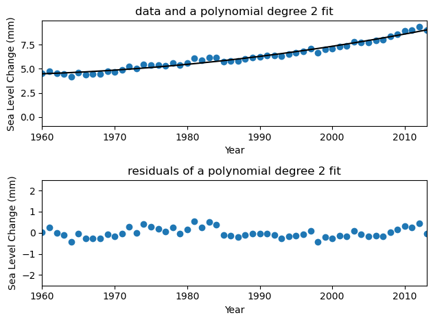

---

## Key findings

- **Both series are accelerating.** A quadratic (curved) model fits both closely, with small, patternless residuals for sea level.
- **Sea level is accelerating much faster than CO₂.** From 1983–1993 to 2003–2013, the rate of sea level rise roughly **quadrupled**, from 0.04 to 0.17 in/yr (about 1 to 4.3 mm/yr). Over the same span, the CO₂ growth rate rose about **30%**, from 1.55 to 2.04 ppm/yr.
- **The relationship is positive but not proportional.** On the linear-trend projections, sea level grows about 28% from 2020 to 2050 while CO₂ grows about 12%. The ocean's response to CO₂ is nonlinear, consistent with delayed effects such as thermal expansion and ice-sheet melt.
- **The projections are conservative.** They extend a straight-line trend, but both series curve upward, so actual values are likely to be higher.

## Skills demonstrated

| Area | Tools / techniques |
|---|---|
| Curve fitting | `np.polyfit` / `np.polyval` linear and quadratic models, RMS residual analysis |
| Nonparametric smoothing | LOWESS (`statsmodels`) at three bandwidths, numerical derivatives of smoothed curves |
| Time-series comparison | Decade-by-decade rates of change, extrapolation, relative-growth comparison |
| Data handling | `pandas` cleaning of missing values (`-99.99` sentinel), monthly vs. yearly series |
| Visualization | `matplotlib` scatter, fit, residual and rate-of-change plots |

> **Units note:** the EPA "CSIRO Adjusted Sea Level" column is measured in **inches** above the 1880 baseline. The original notebook's figures label the axis "mm". The code and tables here use inches, with mm conversions in brackets. The measured rates (about 3 mm/yr for 1993–2003) match published satellite-era estimates, which confirms the unit.

---

## Analysis

All code is in [`scripts/sea_level_co2_analysis.py`](scripts/sea_level_co2_analysis.py). Each numbered step below matches a section of the script.

### 1. Sea level and CO₂ over time

Both series climb steadily from 1960 to 2014. CO₂ also has a visible seasonal cycle that repeats every year.

| Sea level (yearly) | CO₂ at Mauna Loa (monthly) |
|---|---|
| 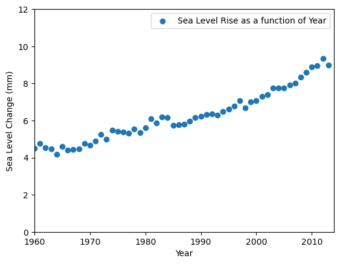 | 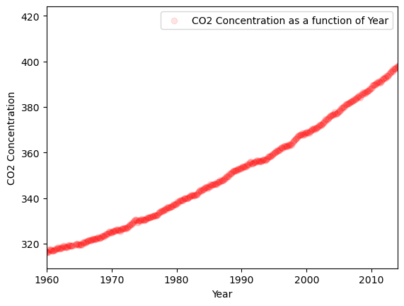 |

### 2. Quadratic model fits

I fit a degree-2 polynomial to each series. For sea level, the residuals stay within about ±0.5 in with no pattern, so a curved model describes the trend well. The CO₂ residuals (RMS 0.72 ppm) show multi-year swings, including a bump around 1990 and a drop after 1992. That timing matches the 1991 Mount Pinatubo eruption, which temporarily slowed CO₂ growth.

| Sea level | CO₂ |
|---|---|
|  | 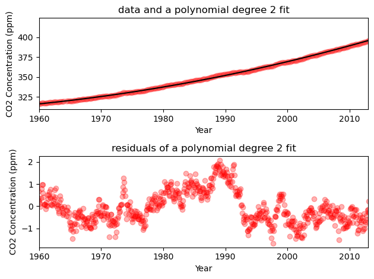 |

### 3. Rate of change by decade

For each 10-year window I estimated the average rate of change in two ways:
- **Linear regression:** the slope of the best-fit line.
- **LOWESS:** fit a smooth local curve at bandwidths `frac` = 0.2, 0.5 and 0.8 (the share of points used for each local fit), then take the average slope of that curve.

| Interval | Sea level, linear | Sea level, LOWESS (0.2 / 0.5 / 0.8) | CO₂, linear | CO₂, LOWESS (0.2 / 0.5 / 0.8) |
|---|---|---|---|---|
| 1983–1993 | 0.04 in/yr (≈1.0 mm) | 0.010 / 0.010 / 0.023 | 1.55 ppm/yr | 1.47 / 1.46 / 1.54 |
| 1993–2003 | 0.12 in/yr (≈3.0 mm) | 0.147 / 0.142 / 0.135 | 1.78 ppm/yr | 1.81 / 1.77 / 1.77 |
| 2003–2013 | 0.17 in/yr (≈4.3 mm) | 0.122 / 0.124 / 0.158 | 2.04 ppm/yr | 2.07 / 2.06 / 2.04 |

The CO₂ estimates agree closely across methods because there are 120 monthly points per window. Sea level has only 11 yearly points per window, so its LOWESS estimates depend much more on the bandwidth.

**Linear fits by decade**

| | Sea level | CO₂ |
|---|---|---|
| **2003–2013** | 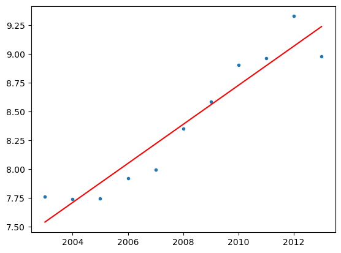 | 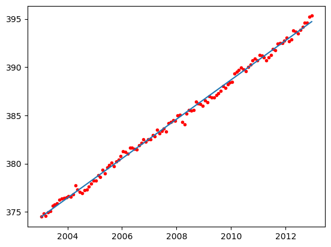 |
| **1993–2003** | 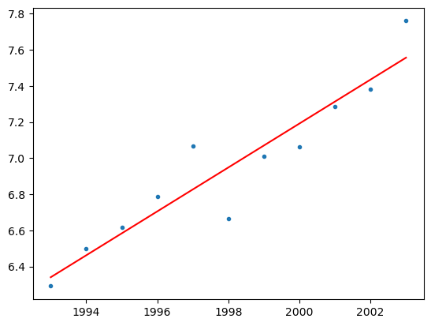 | 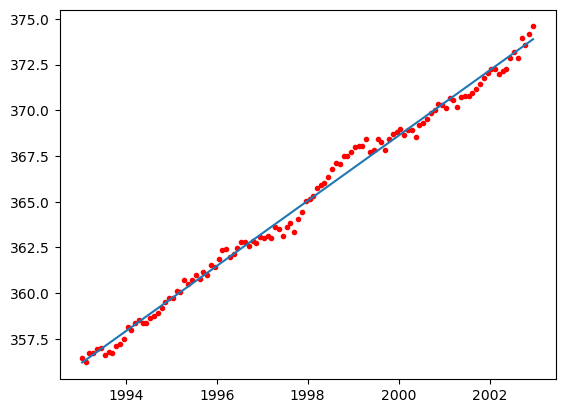 |
| **1983–1993** | 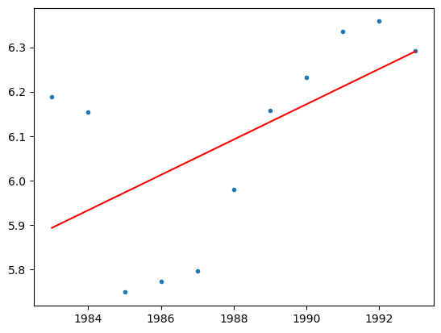 | 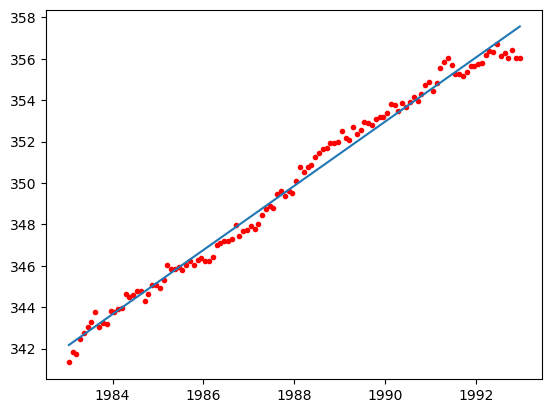 |

**LOWESS rate of change and residuals** (click to expand)

<details>
<summary><b>2003–2013</b></summary>

| | frac = 0.2 | frac = 0.5 | frac = 0.8 | Residuals |
|---|---|---|---|---|
| Sea level | 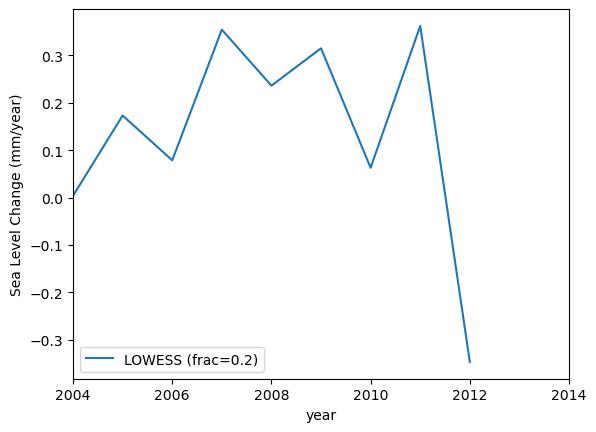 | 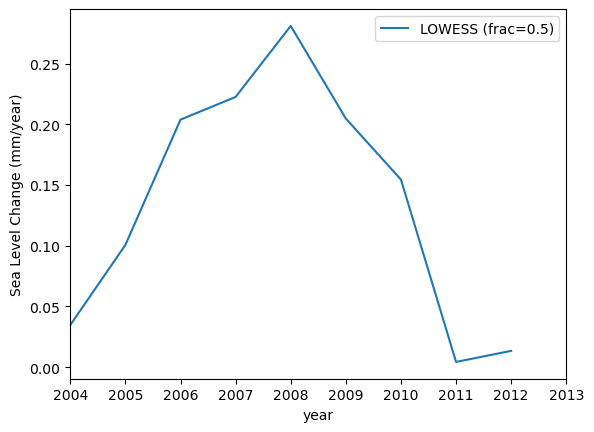 | 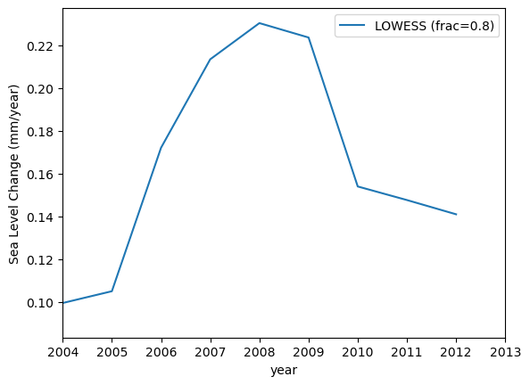 | 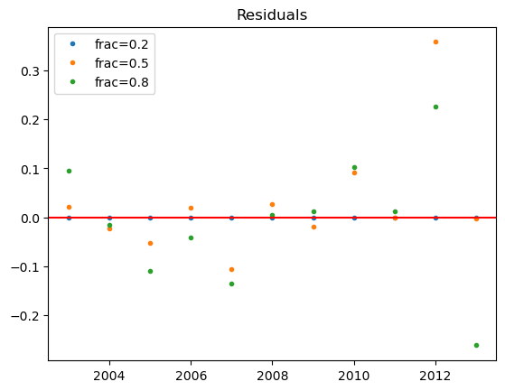 |
| CO₂ | 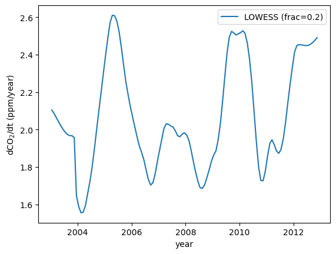 | 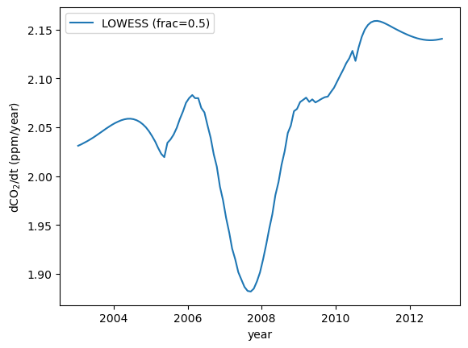 | 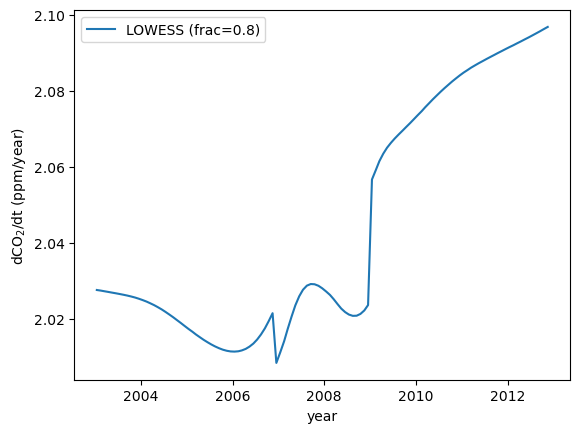 | 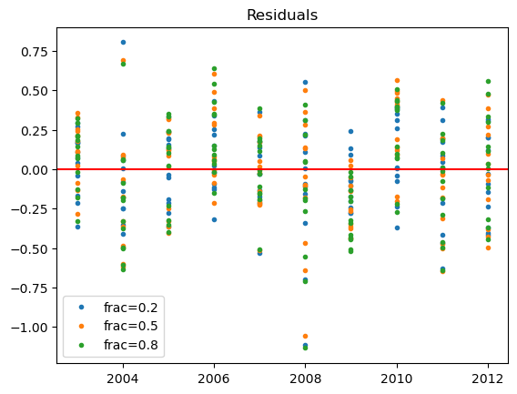 |

</details>

<details>
<summary><b>1993–2003</b></summary>

| | frac = 0.2 | frac = 0.5 | frac = 0.8 | Residuals |
|---|---|---|---|---|
| Sea level | 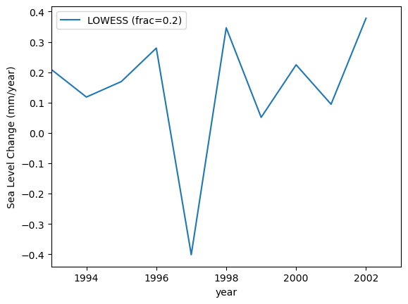 | 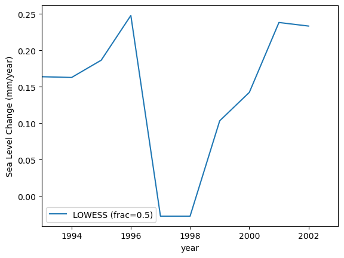 | 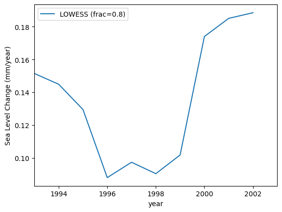 | 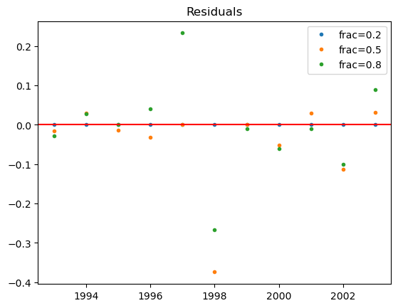 |
| CO₂ | 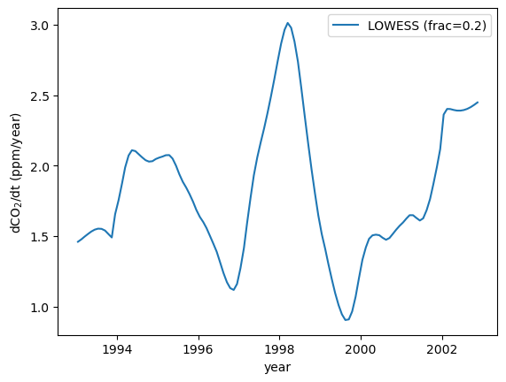 | 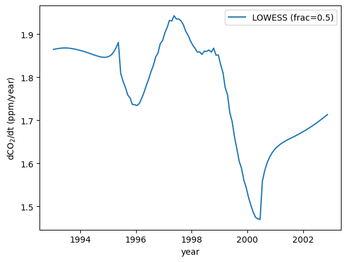 | 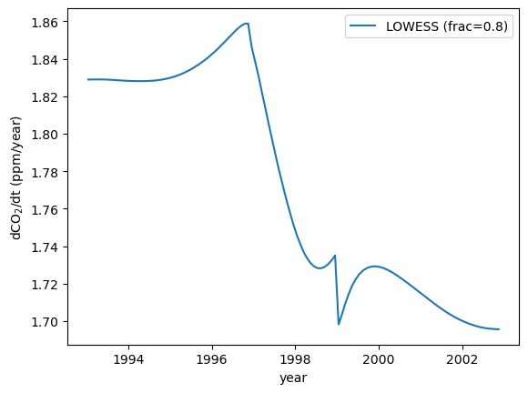 | 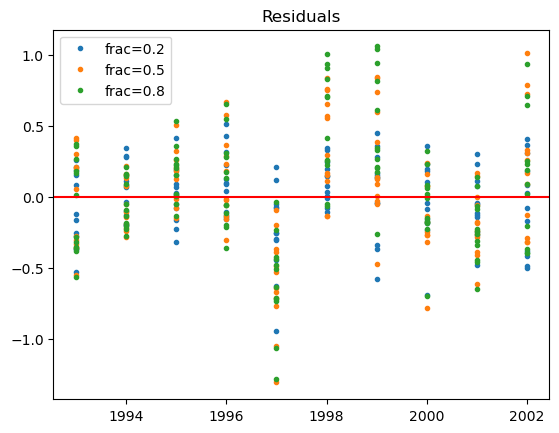 |

</details>

<details>
<summary><b>1983–1993</b></summary>

| | frac = 0.2 | frac = 0.5 | frac = 0.8 | Residuals |
|---|---|---|---|---|
| Sea level | 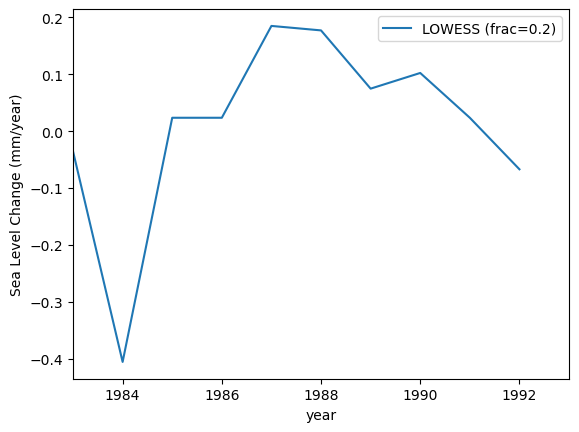 | 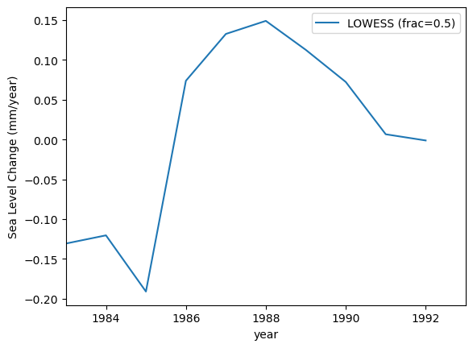 | 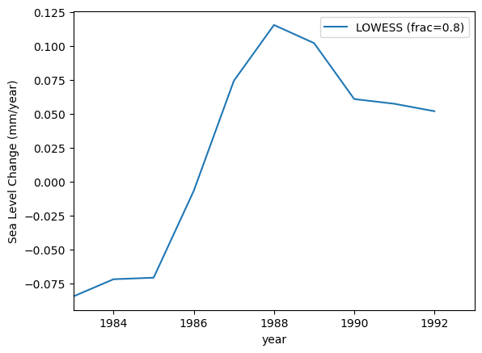 | 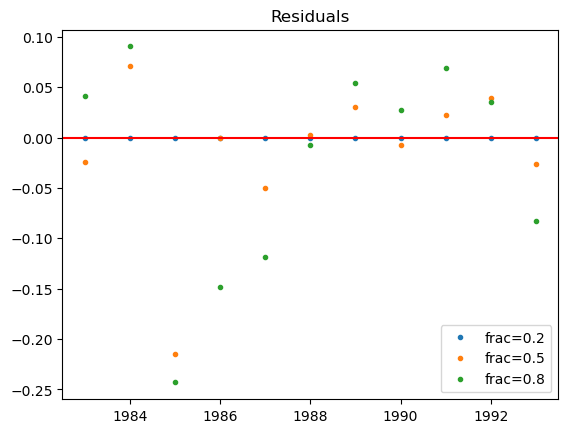 |
| CO₂ | 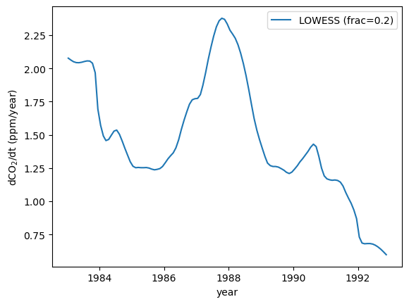 | 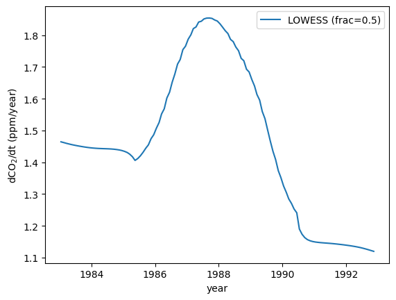 | 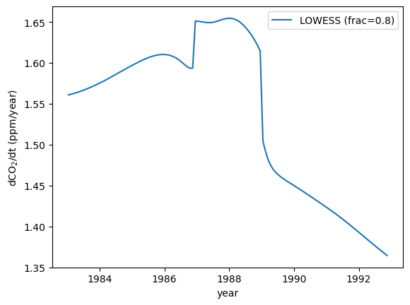 | 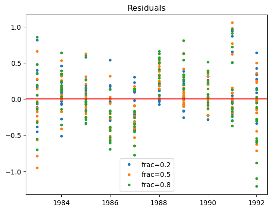 |

</details>

### 4. Projections to 2200 (linear trend)

| Year | CO₂ (ppm) | Sea level above 1880 |
|---|---|---|
| 2020 | 404.89 | 9.09 in (≈231 mm) |
| 2050 | 453.25 | 11.66 in (≈296 mm) |
| 2100 | 533.84 | 15.93 in (≈405 mm) |
| 2200 | 695.03 | 24.47 in (≈622 mm) |

As a check, the measured Mauna Loa annual mean for 2020 was about 414 ppm. The straight-line model's 405 ppm already falls short, which again shows these projections are conservative.

### 5. Is the relationship proportional?

If the two grew in proportion, the ratio of earlier to later values would be the same for both. A lower ratio means faster relative growth.

| Period | Sea level ratio | CO₂ ratio |
|---|---|---|
| 2020 → 2050 | 0.78 (+28%) | 0.89 (+12%) |
| 2100 → 2200 | 0.65 (+54%) | 0.77 (+30%) |

**Conclusion:** sea level and CO₂ rise together, but not in proportion. Sea level grows faster in relative terms, and its rate of rise has accelerated far more than CO₂'s growth rate. That fits a nonlinear, lagged ocean response to warming rather than a simple proportional one. These are correlations, so they show association rather than proof of cause.

---

## Repository layout

```
noaa_sea_level_rise_analysis/
├── README.md
├── requirements.txt
├── scripts/
│   └── sea_level_co2_analysis.py   # full analysis, steps 1–5
├── figures/                        # overview plots (steps 1–2)
│   └── intervals/                  # per-decade linear, LOWESS and residual plots (step 3)
└── data/
    └── README.md                   # where to get the two CSVs
```

## Running the code

```bash
pip install -r requirements.txt
python scripts/sea_level_co2_analysis.py
```

Put the two CSVs in `data/` first (see [`data/README.md`](data/README.md)). The script prints the results above and regenerates every figure in `figures/`.

**Changes from the original Jupyter notebook:** six near-identical interval cells became one reusable function. Sea level units are labeled as inches. The sea level RMS is now computed over the 1960–2013 fit window instead of all years from 1880, which had inflated it to 3.67. Duplicate projection fits were collapsed into one, and the course-grader import (`otter`) was removed.

## Data sources

- **Sea level:** U.S. EPA Climate Change Indicators, CSIRO-adjusted global mean sea level, 1880–2014. Retrieved via https://github.com/datasets/sea-level-rise
- **Atmospheric CO₂:** Scripps CO₂ Program, monthly in-situ measurements at Mauna Loa Observatory, Hawaii, 1958–2021. https://scrippsco2.ucsd.edu/ (C. D. Keeling et al.)
