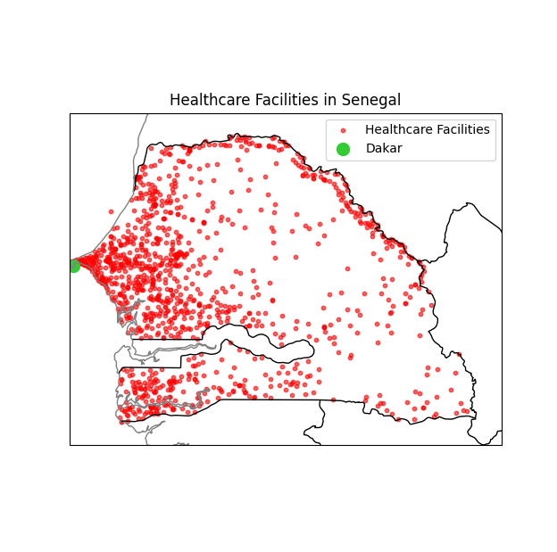
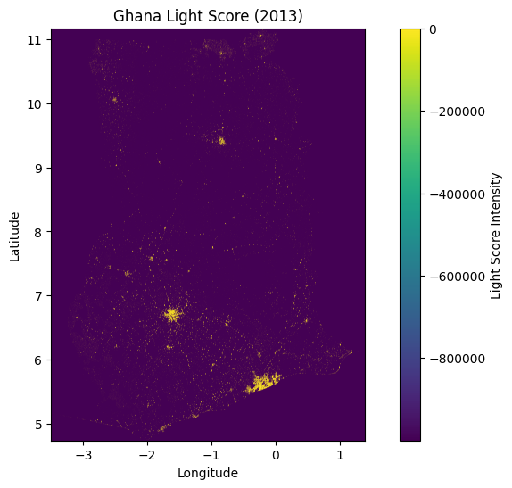
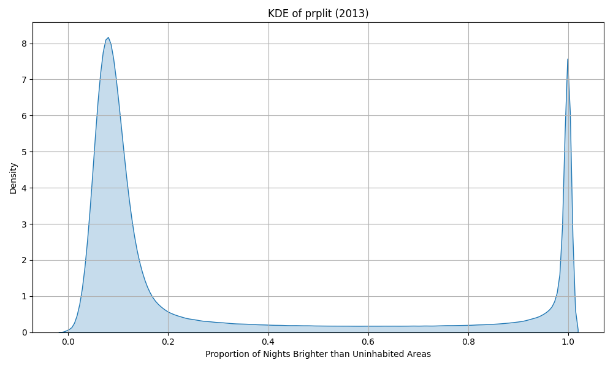
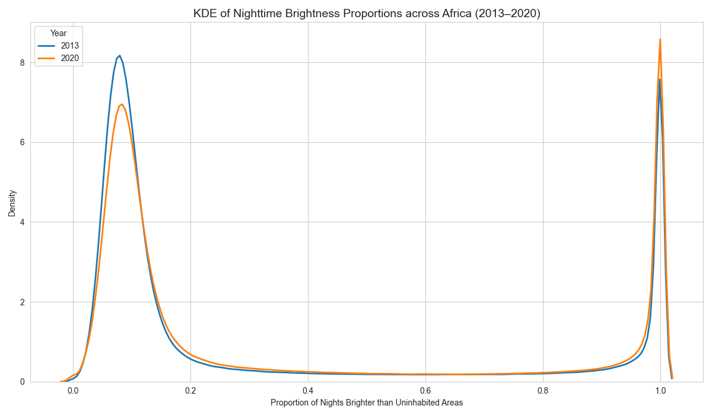
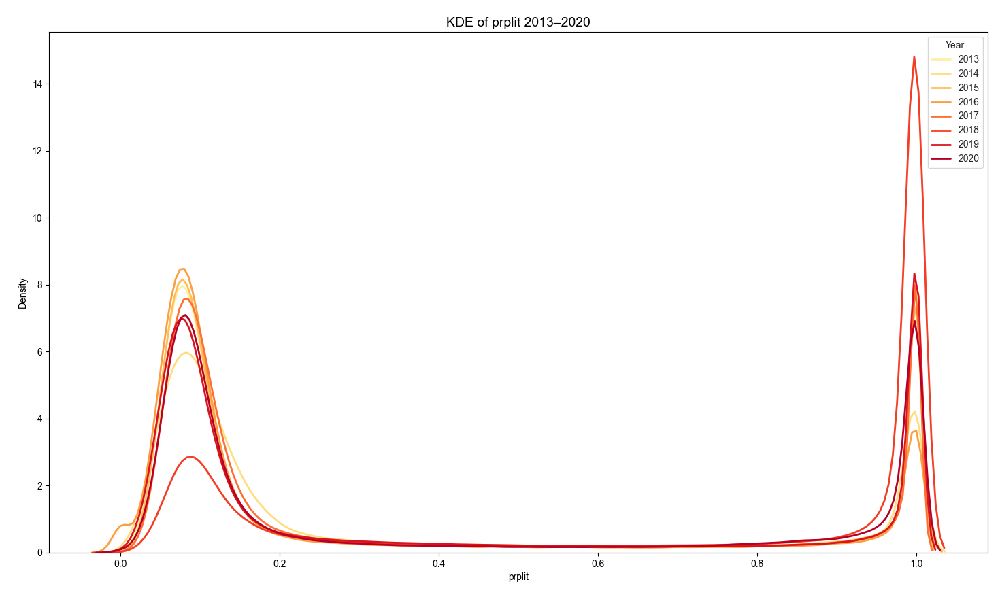
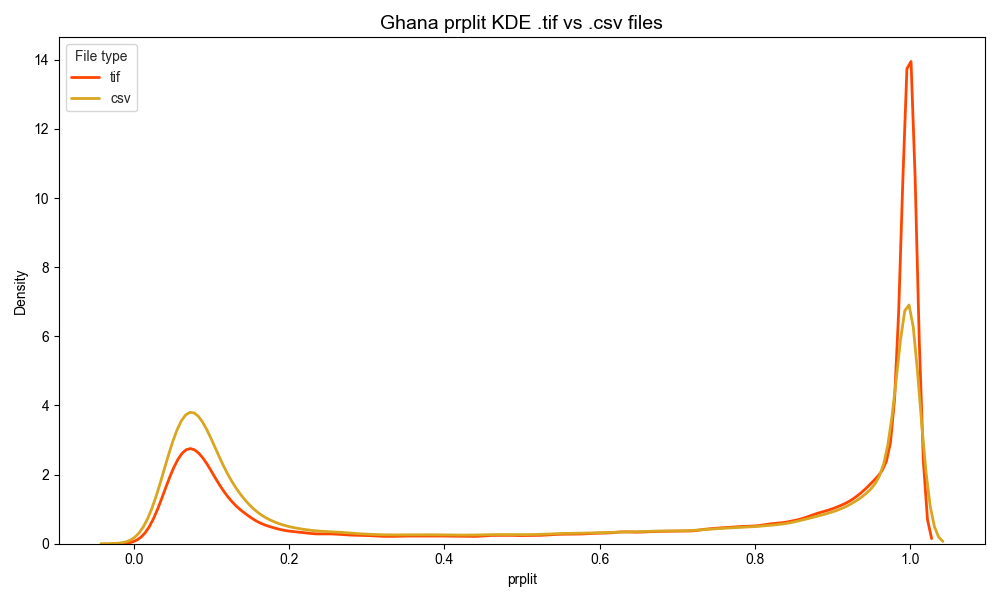

# Power Reliability & Healthcare Access in Sub-Saharan Africa

**Can satellite imagery tell us which health facilities are working without reliable electricity?**

This project builds a geospatial pipeline that pairs the locations of tens of thousands of health facilities across Sub-Saharan Africa with nighttime satellite measurements of electricity access and reliability (2013–2020). The long-term goal is to measure how unreliable power affects healthcare performance, such as cold-chain storage, emergency care and maternal services, at a scale no field survey can reach.

Over eight weeks I mapped facility locations, worked out how to handle country-scale satellite rasters (GeoTIFFs), built a conversion pipeline that turns them into tabular data I could analyze, and used kernel density estimation to describe how electricity reliability is distributed across settlements and how it changed over time.


---

## Key findings so far

- **Facility coverage is uneven.** Facilities cluster heavily in West Africa and along coastlines. Coverage is sparse across the Sahel, Namibia and parts of Angola. Those gaps matter when matching facilities to electricity data.
- **Electricity reliability is bimodal.** Across the continent, settlements tend to be either *almost never* reliably lit (peak near 0.08) or *almost always* lit (peak near 1.0), with few in between. In practice, a settlement is either connected to a working grid or it isn't.
- **Reliability is shifting upward.** From 2013 to 2020, the low-reliability peak shrinks and the high-reliability peak grows.
- **Downsampling has a measurable cost.** Reducing raster resolution to 25% made the data manageable but flattened the high-reliability peak by about half (Week 8). That trade-off has to be accounted for in any downstream facility-level analysis.

## Skills demonstrated

| Area | Tools / techniques |
|---|---|
| Geospatial analysis | `rasterio`, `geopandas`, `cartopy`, affine transforms, raster resampling, Natural Earth shapefiles |
| Data engineering | GeoTIFF → CSV conversion, nodata handling, chunked output for very large files, AWS S3 bulk download |
| Statistics & visualization | Kernel density estimation (`seaborn`), multi-year distribution comparison, `matplotlib` |
| Research workflow | Dataset scoping, weekly iteration, validating that a processing step did not distort the data |

---

## Week-by-week

Each week built on the one before. Scripts are in [`scripts/`](scripts/) and their outputs are in [`figures/`](figures/).

### Week 0 — Scoping the question
**[`week00_project_scoping.py`](scripts/week00_project_scoping.py)**
Defines the research objective: *study the effect of power reliability on healthcare facility performance using large-scale satellite data.* This is a first sketch that loads the facility dataset and plots it on a base map of Africa. I compared candidate datasets in [`docs/datasets.md`](docs/datasets.md) and chose three: HREA electricity reliability, DHS Service Provision Assessments for facility performance, and a geocoded list of Sub-Saharan health facilities.

### Week 1 — Mapping facilities (Senegal as a test case)
**[`week01_facility_scatter_senegal.py`](scripts/week01_facility_scatter_senegal.py)**
Loads the facility spreadsheet, filters it to Senegal and plots facilities by latitude/longitude, with Dakar as a reference point. Then it plots every facility in the dataset. **Why it matters:** this confirms the coordinates are usable and gives a first look at where facilities are concentrated.

### Week 2 — Proper cartographic maps
**[`week02_facility_maps_cartopy.py`](scripts/week02_facility_maps_cartopy.py)**
Rebuilds the Week 1 plots with `cartopy`, adding country borders, coastlines and a geographic projection. **Why it matters:** facilities can now be read against national boundaries, which shows coverage gaps (Sahel, Namibia, Angola) that limit where the electricity comparison is possible.

| Senegal | Sub-Saharan Africa |
|---|---|
|  |  |

### Week 3 — Opening satellite rasters
**[`week03_view_lightscore_tif.py`](scripts/week03_view_lightscore_tif.py)** · **[`week03_view_lightscore_tif_colab.ipynb`](scripts/week03_view_lightscore_tif_colab.ipynb)**
Opens HREA *lightscore* GeoTIFFs (a nighttime brightness measure) for Ghana and Burundi with `rasterio` and renders them on lat/long axes. Locally the plots came out black. Running the same code in Google Colab showed the cause: nodata cells are stored as about −1,000,000, which stretches the color scale so far that real values are hard to see. **Why it matters:** this is the first contact with the electricity data, and it shows that nodata values must be handled explicitly.



### Week 4 — Converting rasters to tables
**[`week04_tif_to_csv.py`](scripts/week04_tif_to_csv.py)**
Data was bulk-downloaded from HREA's AWS S3 bucket ([`data/hrea_catalog.json`](data/hrea_catalog.json) lists all 110+ countries). This script loops over every pixel in each GeoTIFF, converts row/column positions to lat/long with the raster's affine transform, drops null values, and writes `lat, lon, value` CSVs split into 1-million-row chunks. **Why it matters:** facility data is tabular, so the electricity data has to be tabular too before the two can be joined by location.

### Week 5 — Making the pipeline scale
**[`week05_tif_to_csv_downsampled.py`](scripts/week05_tif_to_csv_downsampled.py)**
At full resolution the output was too large to work with. This revision resamples each raster to 25% resolution (average resampling), adjusts the affine transform to match, masks the file's declared `nodata` value, and writes the results to a separate output folder. **Why it matters:** this made continent-wide analysis possible on a laptop.

### Week 6 — Lightscore across Africa
**[`week06_lightscore_map_africa.py`](scripts/week06_lightscore_map_africa.py)**
Combines every converted country CSV and plots lightscore as a color gradient over Natural Earth country borders. **Why it matters:** this is the first continent-wide view of electricity access, on the same spatial frame as the facility maps from Week 2.

### Week 7 — Distribution of electricity reliability, 2013–2020
**[`week07_kde_prplit_by_year.py`](scripts/week07_kde_prplit_by_year.py)**
Switches to **prplit**: the proportion of nights a settlement is statistically brighter than matched uninhabited areas, which serves as a direct proxy for power reliability. For each year from 2013 to 2020, the script combines all country CSVs and plots a kernel density estimate. **Why it matters:** it shows the bimodal pattern (settlements are either mostly dark or mostly lit) and how that pattern shifted over the period, which gives a baseline for classifying the reliability around each facility.

| 2013 | 2013 vs 2020 |
|---|---|
|  |  |



### Week 8 — Validating the downsampling
**[`week08_kde_tif_vs_csv.py`](scripts/week08_kde_tif_vs_csv.py)**
Compares the prplit distribution from the original full-resolution Ghana GeoTIFF with the distribution from the downsampled CSV. **Why it matters:** this is a quality-control check on the Week 5 pipeline. The overall shape holds, but averaging pixels pulls values off the 1.0 peak and into the low tail. Results drawn from the CSVs should be read with that bias in mind.



---

## Next steps

1. Spatially join each facility to the prplit values of its surrounding settlement (buffer or nearest-neighbor).
2. Merge with DHS Service Provision Assessment indicators (e.g. vaccine cold-chain, delivery care, emergency readiness).
3. Model facility performance as a function of power reliability, controlling for urban/rural status and country.

## Repository layout

```
subsaharan_africa/
├── README.md
├── requirements.txt
├── scripts/      # one script per week (week00–week08) + make_sample.py
├── figures/      # outputs referenced above
├── data/
│   ├── sample/   # committed 5% Ghana prplit sample, 2013–2020
│   └── README.md # how to obtain the full data (not committed: too large)
└── docs/         # dataset notes and citations
```

## Running the code

```bash
pip install -r requirements.txt
```

**Try it immediately:** the repo includes a small sample (a 5% random sample of Ghana's prplit data, 2013–2020, about 10 MB) in [`data/sample/`](data/sample/). Week 7 runs on it straight after cloning:

```bash
python scripts/week07_kde_prplit_by_year.py
```

The sample is statistically indistinguishable from the full data: a Kolmogorov–Smirnov test gives D ≈ 0.005 and p > 0.3 for every year. It was built with [`scripts/make_sample.py`](scripts/make_sample.py).

The full dataset isn't included because the cleaned CSVs are about 27 MB per country-year, tens of GB in total. See [`data/README.md`](data/README.md) for download steps. All scripts read from the project's `data/` folder, and Week 7 uses the full data automatically when it's present.

## Data & citation

Electricity data: **High Resolution Electricity Access (HREA)**, University of Michigan.
Brian Min, Zachary P. O'Keeffe, Babatunde Abidoye, Kwawu Mensan Gaba, Trevor Monroe, Benjamin P. Stewart, Kim Baugh, Bruno Sánchez-Andrade Nuño. "Lost in the Dark: A Survey of Energy Poverty from Space." *Joule* (2024). https://doi.org/10.1016/j.joule.2024.05.001

Facility performance: DHS Program, Service Provision Assessment (SPA). https://dhsprogram.com/Methodology/Survey-Types/SPA.cfm
